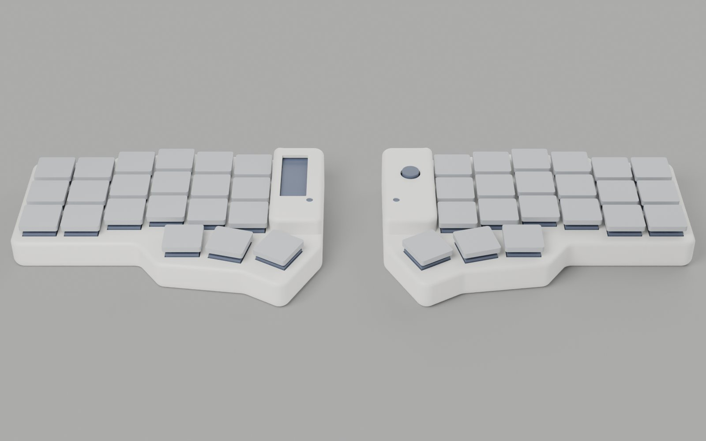
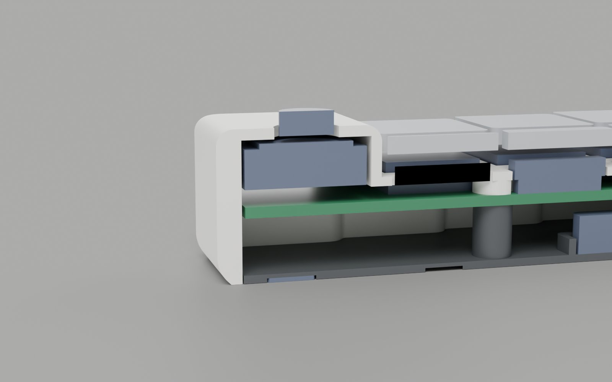

# Corne LP case

Two-piece PETG wrap case for the Corne LP (corne-chocolate v3 / Helidox), nice!nano, left OLED, right holykeebs TrackPoint.




- `shell`: deck, walls and controller hump in one piece. The switches are soldered, so the deck is a cover with 15.8 mm holes rather than a switch plate. Take the keycaps off, then slide the PCB with its switches in from below; the cavity runs straight down and clears the switch housings that overhang the PCB edge. The hump covers the nice!nano, OLED, reset switch and TRRS jack (no opening for the jack); the left one has a window the size of the OLED module less its header
- `floor`: drops in from below, so the only seam is on the bottom; has the MagSafe ring recess and battery fences
- 5 × M2×12 countersunk screws go up through the floor and PCB and thread straight into 1.8 mm pilot holes in bosses under the deck, which clamps shell, PCB and floor together. Lay the PCB into the upturned shell, then screw the floor on; go gently, it is ~2.5 mm of thread in PETG. Heads sit 1.6 mm up in wells in the floor
- TrackPoint (right hump): the holykeebs module stacks on the nice!nano and its stick comes up through a 9.5 mm hole in the hump roof (cap + 1.5 mm, so the cap can tilt). Fit the cap after the PCB is in. The sensor has to clear the roof underside (10.8 mm above the PCB) by 0.3 mm
- Feet: 3M SJ5376 bumpons (Ø8) in 0.6 mm recesses, 4 per half. The two halves' feet are staggered so they nest when stacked back to back
- No power switch: use `&soft_off`, and press reset to wake. `reset_pin` is a loose printed pin in the hump's reset hole: it rests on the switch with its top 0.3 mm under the surface, and a flange stops it falling out. Print one per half, standing on the flange. Its length assumes a 4.3 mm tall switch (`reset_sw`)

Heights (without feet, which add 2.2 mm): 14.6 mm at the keys, 23.5 mm at the hump. The PCB top sits 11.1 mm above the desk; the 6 mm battery (EEMB 603449) under the hotswap sockets sets this.

## Build

```sh
nix shell nixpkgs#uv -c uv run --python 3.12 --with manifold3d --with shapely --with numpy case.py   # -> models/*.stl
/Applications/Blender.app/Contents/MacOS/Blender -b -P render.py                                       # -> renders/*.jpg
```

Dimensions live in `P` at the top of `case.py`; the build asserts that the PCB with everything soldered on slides in from below. `pcb.json` holds the PCB outline and footprint positions from [foostan/crkbd v3-final](https://github.com/foostan/crkbd/blob/v3-final/corne-chocolate/pcb/corne-chocolate.kicad_pcb).

## Print

PETG, 0.2 mm layers. Print the floor flat. Print the shell upright (open side down) with tree supports under the deck and hump roof; the bottom edge is a 45° chamfer so it needs none there. Use a 0.2–0.25 mm support top gap, since PETG fuses to tight supports.

Estimated, check before printing: nice!nano height on the stock headers (2.5 mm spacer; the USB-C opening is centred on it), OLED stack height, TrackPoint stack and cap (`tp_sensor_z`, `tp_cap`; stick position over the nano), reset switch height, keycap skirt depth (the deck top is 1.5 mm below the switch housing top).
